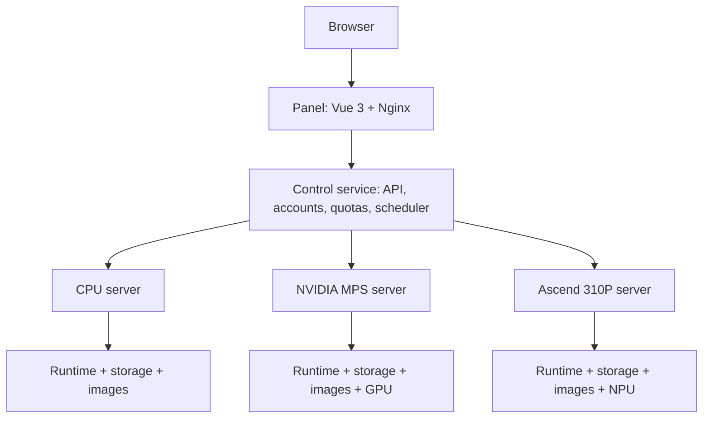

# GPU Platform

Turn your servers into a shared workspace for dev environments and batch jobs. Pick a server, request compute and storage, and connect over SSH or VS Code. Manage accounts, quotas, images, shared datasets, and scheduling from one web panel.

[简体中文](README.zh-CN.md) · [User guide](docs/en/user-guide.md) · [Deployment](docs/en/operations.md) · [Configuration](docs/en/configuration.md) · [Modules](docs/en/modules.md) · [API](docs/en/api.md)

## Quickstart

Start with Ubuntu 22.04 or 24.04 on AMD64 or ARM64, mounted data disks, and the driver for your accelerator. From the repository root:

```bash
cp config/platform.default.yaml cluster.yaml
# Set your public host, architecture, storage paths, and modules in cluster.yaml.
sudo ./packages/installer/bootstrap.sh
sudo platformctl install --config cluster.yaml --host main
```

The installer prepares host dependencies and starts the platform with Docker Compose. Open `http://YOUR_HOST:8000`, sign in as `admin` with the password in the generated root-only `.env`, and change it. See the [deployment guide](docs/en/operations.md) for image preparation, adding servers, and HTTPS setup.

Use Compose for everyday inspection:

```bash
sudo docker compose -f /var/lib/gpu-platform/deploy/main/compose.yaml ps
sudo docker compose -f /var/lib/gpu-platform/deploy/main/compose.yaml logs --tail 100
```

## Capabilities

### Decoupled panel and modular services

The web panel is a standalone Vue 3 application served by Nginx that talks to the control service strictly through `/api/v1`. Ten extension slots adapt authentication, transport, login entry, runtime, storage, image registry, builds, accelerators, metrics, and notifications to your hardware.



| Environment | How it fits |
| --- | --- |
| A lab with one server | Run the panel, control service, and execution node together; set `gpu: null` for CPU-only workloads. |
| A team sharing GPUs | Allocate NVIDIA compute and GPU memory per task, including shared, whole-card, and multi-GPU requests. |
| ARM servers with Ascend 310P | Select the built-in Ascend module for exclusive NPU chip allocation. |
| Existing infrastructure | Package custom modules for directory login, storage, or runtime; connect remote servers over reverse SSH. |

### Interactive dev environments and batch jobs

Upload your SSH public key once in **Account & access** and use it on every server, including running environments. Connect with SSH or VS Code, keep personal files in your home volume (`/home/<user>`) and task files in your work volume (`/workspace`), and run Rootless Docker inside the environment within your task's limits.

### Reusable images and shared data

Build images from a Dockerfile, save a configured dev environment as an image, or turn a running dev environment directly into a batch job. Share prepared images and read-only datasets (`/datasets`) with your team, and copy images or datasets between servers from the **Data sync** page.

### Quotas, scheduling, and visibility

Set member and user-group quotas, manual or automatic approval, reservations, queues, and automatic expiry. Track live hardware load, historical metrics, usage statistics, and audit events from the administration console. Automate workflows through the HTTP API and bundled Agent skill. The interface supports English and Simplified Chinese, with light and dark themes.

## Documentation

| Goal | Guide |
| --- | --- |
| Request environments, manage SSH keys, and reuse images | [User guide](docs/en/user-guide.md) |
| Install, add servers, back up, or upgrade | [Deployment and operations](docs/en/operations.md) |
| Tune storage pools, caches, quotas, sync, and HTTPS | [Configuration reference](docs/en/configuration.md) |
| Select built-in modules or write custom slot modules | [Module guide](docs/en/modules.md) |
| Automate tasks via HTTP API or Agent skill | [API and Agent skill](docs/en/api.md) |
| Understand packages, services, and data flow | [Architecture](docs/en/architecture.md) |
| Review access controls, isolation, and backup scope | [Security](docs/en/security.md) |
| Run the backend and Vue panel locally | [Development](docs/en/development.md) |
