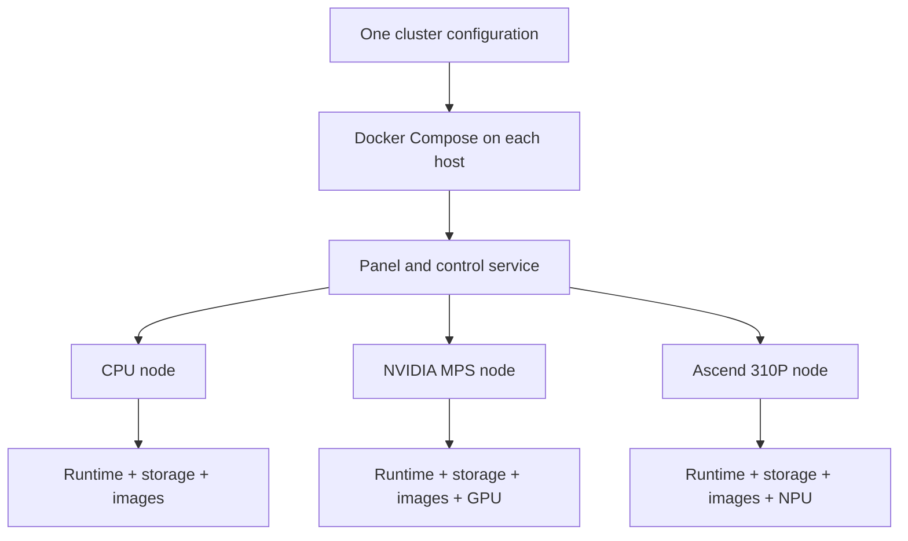

# GPU Platform

Turn your servers into a shared workspace for development and batch jobs. Choose a machine, request resources, and connect over SSH or VS Code. Manage accounts, images, storage, and scheduling in one place.

[简体中文](README.zh-CN.md) · [Deployment](docs/en/operations.md) · [Modules](docs/en/modules.md) · [API](docs/en/api.md) · [Development](docs/en/development.md)

## Quickstart

Start with Ubuntu 22.04 or 24.04 on AMD64 or ARM64, mounted data disks, and the driver for your accelerator. From the repository root:

```bash
cp config/platform.default.yaml cluster.yaml
# Set your public host, architecture, storage paths, and modules in cluster.yaml.
sudo ./packages/installer/bootstrap.sh
sudo platformctl install --config cluster.yaml --host main
```

The installer prepares host dependencies and starts the platform with Docker Compose. Open `http://YOUR_HOST:8000`, sign in as `admin` with the password in the generated root-only `.env`, and change it. The [deployment guide](docs/en/operations.md) covers image preparation and configuration.

Use Compose for everyday operations:

```bash
sudo docker compose -f /var/lib/gpu-platform/deploy/main/compose.yaml ps
sudo docker compose -f /var/lib/gpu-platform/deploy/main/compose.yaml logs --tail 100
```

## Why GPU Platform?

### 🧩 Modules that fit your servers

Choose authentication, networking, runtime, storage, accelerator, and other modules for each deployment. Ten extension slots let you adapt the platform to your infrastructure. External modules use the same contracts as the built-in ones.



| Your setting | How it fits |
| --- | --- |
| A lab with one server | Run the panel and execution node together; disable the accelerator slot for CPU work. |
| A team sharing GPUs | Allocate NVIDIA compute and memory per task, including shared and multiple GPUs. |
| ARM servers with Ascend 310P | Select the built-in Ascend module for exclusive NPU allocation. |
| An organization with its own infrastructure | Add a module for organization login, storage, or runtime; connect remote nodes through SSH transport. |

See [module choices and extension examples](docs/en/modules.md).

### 🐳 Deploy with Docker Compose

One cluster file describes your hosts and their modules. The installer checks the combination, prepares each machine, and generates its Compose services. Start on one server and add execution nodes as your team grows.

### 💻 A complete development environment

Upload your SSH public key once and use it for your environments across all nodes. Key changes also reach running environments. Connect with SSH or VS Code, use persistent home and work volumes, and run Docker inside the environment with the task's resource limits.

### 📦 Reuse your work

Build an image from a Dockerfile, save a configured environment, or turn it into a batch job. Share prepared images and read-only datasets with your team. Synchronize images between nodes of the same CPU architecture and public data between nodes; personal and work volumes stay on their own node.

### 👥 Share compute with clear limits

Manage member and group quotas, approvals, reservations, queues, and automatic environment expiry. Check task logs, hardware metrics, and audit events from the panel. The HTTP API and bundled agent skill support automation; the panel is available in English and Simplified Chinese.

## Explore

| I want to… | Start here |
| --- | --- |
| Install, add a node, or upgrade | [Deployment and operations](docs/en/operations.md) |
| Choose or write a module | [Module guide](docs/en/modules.md) |
| Understand how the parts fit | [Architecture](docs/en/architecture.md) |
| Automate resource requests | [API and agent skill](docs/en/api.md) |
| Review access and data boundaries | [Security](docs/en/security.md) |
| Run the project locally | [Development](docs/en/development.md) |
