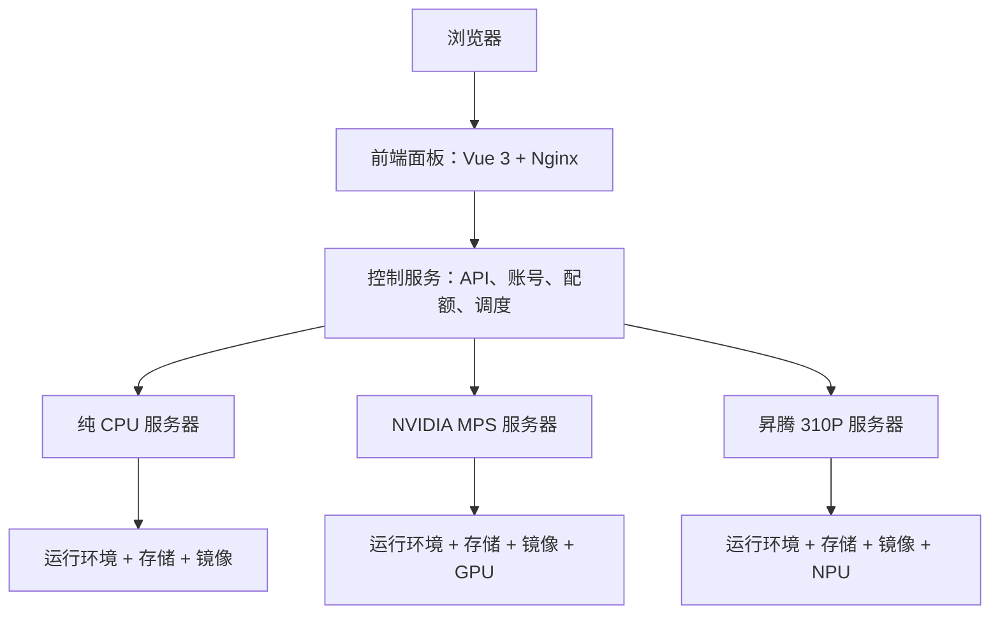

# GPU Platform

把服务器变成团队共享的开发环境和批处理计算平台。选一台服务器、申请算力与存储，即可通过 SSH 或 VS Code 开始工作；账号、配额、镜像、共享数据集和调度都集中在同一个网页控制台里管理。

[English](README.md) · [用户使用指南](docs/zh/user-guide.md) · [部署与运维](docs/zh/operations.md) · [配置参考](docs/zh/configuration.md) · [模块扩展](docs/zh/modules.md) · [API](docs/zh/api.md)

## 快速开始

准备一台 Ubuntu 22.04 或 24.04 服务器（支持 AMD64 和 ARM64），挂载好数据盘并安装加速卡驱动，然后在仓库根目录执行：

```bash
cp config/platform.default.yaml cluster.yaml
# Set your public host, architecture, storage paths, and modules in cluster.yaml.
sudo ./packages/installer/bootstrap.sh
sudo platformctl install --config cluster.yaml --host main
```

安装器会准备主机依赖，并通过 Docker Compose 启动平台。打开 `http://YOUR_HOST:8000`，使用生成的仅 root 可读的 `.env` 中的密码登录 `admin`，随后修改密码。镜像准备、添加服务器和 HTTPS 配置见[部署与运维](docs/zh/operations.md)。

日常直接使用 Compose 查看状态和日志：

```bash
sudo docker compose -f /var/lib/gpu-platform/deploy/main/compose.yaml ps
sudo docker compose -f /var/lib/gpu-platform/deploy/main/compose.yaml logs --tail 100
```

## 核心能力

### 独立前端面板与模块化服务

前端面板是独立的 Vue 3 单页应用，由 Nginx 容器托管并通过 `/api/v1` 与控制服务通信。十个扩展插槽覆盖认证、通信、SSH 入口、运行环境、存储、镜像仓库、构建、加速卡、监控与通知，按服务器需求自由组合。



| 使用场景 | 组合方式 |
| --- | --- |
| 实验室单台服务器 | 控制服务、前端面板与执行节点部署在同一台主机；纯 CPU 任务可将加速卡模块设为 `null`。 |
| 团队共享 GPU | 按任务分配 NVIDIA 算力与显存，支持共享单卡、整卡独占和多卡申请。 |
| ARM 服务器搭配昇腾 310P | 选择内置 Ascend 模块，按整颗 NPU 独占分配。 |
| 接入已有基础设施 | 编写扩展模块对接统一登录、存储或运行环境，通过反向 SSH 连接远程服务器。 |

### 交互式开发环境与批处理任务

在**账号与访问**上传一次 SSH 公钥，即可用于所有服务器上的开发环境，变更会自动同步到运行中的环境。通过 SSH 或 VS Code 登录，在个人卷（`/home/<用户名>`）保存个人配置，在工作卷（`/workspace`）保存代码与检查点，并可在环境内运行受任务配额约束的 Rootless Docker。

### 镜像复用与共享数据

通过 Dockerfile 构建镜像，把配置好的开发环境保存为新镜像，或直接将运行中的开发环境转为批处理任务。团队可以共用镜像与只读共享数据集（`/datasets`），并在**数据同步**页面跨服务器复制镜像或数据集。

### 配额、调度与可观测性

按成员与用户组配置配额、审批策略、预约时间段、排队与到期自动停止。管理员可在控制台查看实时负载、历史记录、用量统计与审计日志；用户可通过 HTTP API 和随附的 Agent skill 自动化操作。界面支持简体中文与英文，以及浅色与深色主题。

## 文档导航

| 想做什么 | 阅读文档 |
| --- | --- |
| 申请开发环境、管理 SSH 密钥、复用镜像与排障 | [用户使用指南](docs/zh/user-guide.md) |
| 安装平台、添加服务器、备份与升级 | [部署与运维](docs/zh/operations.md) |
| 调整存储池、缓存、配额、定时同步与 HTTPS | [配置参考](docs/zh/configuration.md) |
| 选择内置模块或开发自定义模块 | [模块指南](docs/zh/modules.md) |
| 使用 HTTP API 或 Agent skill 自动化提交任务 | [API 与 Agent skill](docs/zh/api.md) |
| 了解包结构、服务职责与任务流转 | [系统架构](docs/zh/architecture.md) |
| 查看权限边界、环境隔离与备份范围 | [安全说明](docs/zh/security.md) |
| 在本地运行后端服务与 Vue 前端面板 | [开发指南](docs/zh/development.md) |
