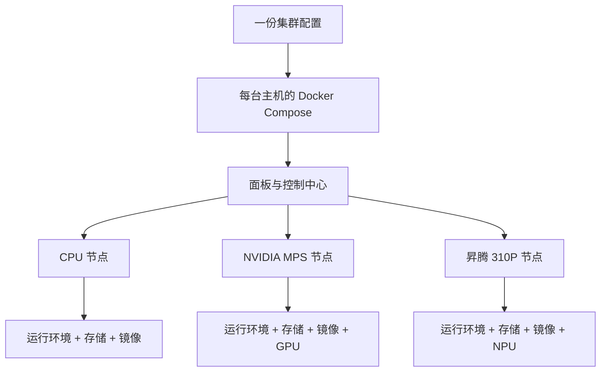

# GPU Platform

把服务器变成团队共享的开发与计算平台。选一台机器、申请资源，就能通过 SSH 或 VS Code 开始工作；账号、镜像、存储和任务调度都在同一个面板里管理。

[English](README.md) · [部署指南](docs/zh/operations.md) · [模块扩展](docs/zh/modules.md) · [API](docs/zh/api.md) · [参与开发](docs/zh/development.md)

## 快速开始

准备一台 Ubuntu 22.04 或 24.04 服务器，支持 AMD64 和 ARM64。挂载好数据盘，安装所用加速卡的驱动，然后在仓库根目录执行：

```bash
cp config/platform.default.yaml cluster.yaml
# Set your public host, architecture, storage paths, and modules in cluster.yaml.
sudo ./packages/installer/bootstrap.sh
sudo platformctl install --config cluster.yaml --host main
```

安装器会准备主机依赖，并通过 Docker Compose 启动平台。打开 `http://YOUR_HOST:8000`，使用生成的、仅 root 可读的 `.env` 中的密码登录 `admin`，随后修改密码。镜像准备和配置方法见[部署指南](docs/zh/operations.md)。

日常直接使用 Compose：

```bash
sudo docker compose -f /var/lib/gpu-platform/deploy/main/compose.yaml ps
sudo docker compose -f /var/lib/gpu-platform/deploy/main/compose.yaml logs --tail 100
```

## 为什么选择 GPU Platform？

### 🧩 按场景组合模块

认证、通信、运行环境、存储、加速卡等能力都可以按部署需要选择。平台提供十个扩展插槽，内置模块和自定义模块使用同一套接口，方便接入自己的基础设施。



| 使用场景 | 怎么组合 |
| --- | --- |
| 实验室的一台服务器 | 面板和执行节点部署在一起；纯 CPU 任务可以关闭加速卡模块。 |
| 团队共享 GPU | 按任务分配 NVIDIA 算力和显存，支持共享、整卡和多卡。 |
| ARM 服务器搭配昇腾 310P | 选择内置 Ascend 模块，按整颗 NPU 独占分配。 |
| 学校或企业的自有环境 | 编写模块接入统一认证、存储或运行环境，通过 SSH 通信模块连接远程节点。 |

具体选择与扩展示例见[模块指南](docs/zh/modules.md)。

### 🐳 使用 Docker Compose 部署

一份集群配置描述所有主机及其模块。安装器检查模块组合、准备各台机器，并生成对应的 Compose 服务。从单机起步，团队需要更多资源时再添加执行节点。

### 💻 开发环境开箱可用

SSH 公钥上传一次，就能用于所有节点上属于你的开发环境，修改后也会同步到运行中的环境。通过 SSH 或 VS Code 登录，使用独立持久化的个人卷和工作卷，在容器里直接运行 Docker，并共享任务获分配的资源额度。

### 📦 配好的环境继续用

通过 Dockerfile 构建镜像，把配置好的开发环境保存下来，或者直接转为批处理任务。团队可以共用准备好的镜像和只读数据集。相同 CPU 架构的节点之间可以同步镜像，节点之间可以同步公共数据；个人卷和工作卷保留在所属节点。

### 👥 多人共享，管理有序

按成员和用户组设置配额，管理审批、预约、排队和开发环境到期停止。面板集中展示任务日志、硬件监控和审计记录，HTTP API 与随附的 Agent skill 支持自动化操作，界面可切换英文和简体中文。

## 继续了解

| 想做什么 | 从这里开始 |
| --- | --- |
| 安装、添加节点或升级 | [部署与维护](docs/zh/operations.md) |
| 选择模块或编写扩展 | [模块指南](docs/zh/modules.md) |
| 了解各部分如何配合 | [系统架构](docs/zh/architecture.md) |
| 自动申请资源和运行任务 | [API 与 Agent skill](docs/zh/api.md) |
| 查看权限与数据边界 | [安全说明](docs/zh/security.md) |
| 在本地运行项目 | [开发指南](docs/zh/development.md) |
