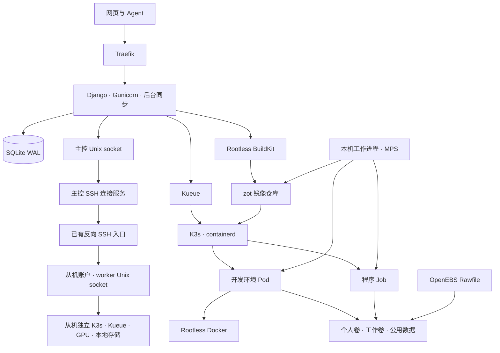
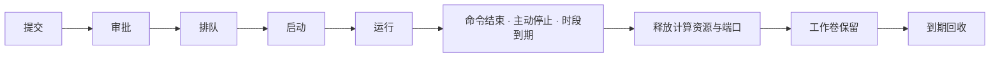

# 系统架构

一台主控提供 Django 网页、API、业务数据库和统一审批。主控本机及各从机分别运行独立的单节点 K3s；每个执行节点具备相同的 Kueue、Rawfile、镜像仓库、构建和 GPU 服务。从机不启动面板。

## 组件

| 组件 | 职责 |
| --- | --- |
| Django | 账号、公钥、用户组、申请、审批、任务、镜像、存储和审计 |
| SQLite WAL | 保存业务记录，使用持久卷；应用采用单实例 `Recreate` 更新 |
| 后台同步 | 同步任务与构建状态、资源余量和卷用量，执行到期回收 |
| `gpu-platform-links.service` | 主控持有节点专属 SSH 私钥，复用 SSH 连接，转发节点 RPC 和任务 SSH 端口 |
| `gpu-platform-worker.service` | 从机提供有界 JSON RPC，通过本地 Unix socket 操作本机集群、仓库和只读公用目录 |
| K3s / containerd | 创建 Pod、Job、Service、Secret 和 PVC，执行 CPU 与内存限制 |
| Kueue | 每用户队列、资源借用、并发任务限制和任务准入 |
| `gpu-platform-node.service` | GPU 库存、多卡分配、租约回收、容器环境保存和本机镜像清理 |
| `gpu-platform-mps.service` | 主机 MPS 服务，管理 GPU 计算分区 |
| OpenEBS Rawfile | 在数据盘上创建独立的卷文件系统，执行容量限制 |
| zot / Rootless BuildKit | 按用户保存镜像，构建 Dockerfile，记录 digest 和构建日志 |
| LXCFS | 向工作容器提供按申请额度显示的 CPU 和内存信息 |

`backend/supervise.py` 管理 Web 和同步两个进程。子进程退出后，应用容器退出，由 Kubernetes 重启；健康接口检查 Web 与同步心跳。

同步进程按节点并发执行，查询和配置在一轮同步中绑定节点。Kubernetes API、镜像仓库及文件浏览请求通过 SSH 传递；主从之间不要求 Pod 网段互通。每条 RPC 限制消息大小和超时，每轮节点同步有时间预算。

节点不可达时保留数据库中的任务、租约归属及端口，不根据连接失败推断容器消失。从机本地进程按任务结束时间停止过期开发环境；恢复连接后继续同步和清理。维护模式停止新派发并继续管理既有任务。

## 任务生命周期

审批事务检查用户组配额和所选节点存储空间，预留卷容量、固定镜像 digest，并创建 Workspace。每个节点为用户维护 Kueue LocalQueue / ClusterQueue；主控在派发事务中跨节点检查同一用户的总算力、总显存、CPU、内存和并发额度。SSH 端口也使用全局池。

开发环境使用带准入门的 Pod，按开始和结束日期运行。程序使用初始挂起的 Job，准入后执行 Shell 命令，以退出码记录结果。任务派发标记持久化，已派发对象丢失时记录失败。计算对象和 Service 清理完成后释放 SSH 端口。

CPU、内存余量取自节点可分配量与 Pod 的资源请求；GPU 余量取自本机分配记录。申请页每 15 秒刷新余量，资源概览、时间轴与 API 使用相同数据。

## GPU 共享与多卡

每次申请用 `gpu_requests` 数组逐卡填写算力百分比和显存 GiB。数组顺序对应 CUDA 设备顺序，物理 GPU 由节点工作进程匹配。分配结果记录在 `Workspace.gpu_devices` 和 `gpu_allocations`，包含物理编号、UUID、SM 数和显存。

Kueue 使用 `gpu.platform/compute` 和 `gpu.platform/memory-mib` 汇总算力百分点与显存。任务准入后，本机工作进程同时检查所有目标卡，预留完整组合，再建立各卡的 MPS 分区。资源不足时任务继续排队，同卡已有任务继续使用自己的份额。

MPS v3 将每个任务的 namespace 绑定到静态 SM 分区；NVIDIA 驱动按外层容器 cgroup 限制逐卡显存。内层 Docker 共用该任务的分区和显存额度。以 114 SM 的 RTX 4090 D 为例，100%、50%、25% 分别分配 114、56、28 SM。算力比例表示 SM 份额，SM 数按分配粒度取整。

GPU 使用 `EXCLUSIVE_PROCESS` 模式，主机 MPS 服务持有计算上下文。OCI 钩子在启动前校验任务租约并设置显存限制。任务停止后，工作进程等待容器退出，再删除 namespace、分区和租约。

工作进程重启后继续管理现有分区。MPS 服务异常导致 GPU 上下文失效时，平台结束受影响任务，等待旧容器与 cgroup 释放，再恢复可分配容量。

## 数据保存

| 内容 | 位置 | 生命周期 |
| --- | --- | --- |
| 个人卷 | 容器 `/home/<网站用户名>` | 同账号在同节点共享，长期保留，可由管理员扩容或删除 |
| 工作卷 | 容器 `/workspace` | 每任务独立，结束后默认保留 3 天 |
| 内层 Docker 数据 | `/workspace/.docker` | 随工作卷保存 |
| 程序与 Docker 日志 | `/workspace/.platform` | 随工作卷保存 |
| 公用数据 | 主机 `storage.datasets`，工作容器 `/datasets` | 管理员通过 SSH 维护，容器与网页只读 |
| 平台数据库 | 应用持久卷 | 保存账号、申请、镜像和审计记录 |
| 镜像内容 | zot 持久卷 | 按镜像保留策略回收 |
| GPU 租约 | 主机 `/var/lib/gpu-platform/gpu/leases` | 任务释放后删除 |
| MPS 接入与日志 | 主机 `/var/lib/gpu-platform/gpu/pipes`、`logs` | 由 GPU 服务管理 |
| 本机镜像清理重试 | `/var/lib/gpu-platform/image-cleanup` | 清理成功后删除 |

节点绑定任务、存储池、卷、镜像、构建和观测数据。存储池对应该节点独立数据盘，每个卷放在一块容量充足的盘上。审批同时考虑实时空闲、逻辑预留、待绑定卷和池缓冲。主控数据库默认另占 10 GiB；每个节点的镜像仓库默认另占 300 GiB，从机数据库预算为 0。

同名池和相同目录可以存在于不同节点。镜像只在其所属节点及架构使用；从已有环境运行程序必须选择同一节点，卷复制也在该节点内完成。

Rawfile 使用独立 ext4 文件系统、实际容量预分配和 `nodiscard` 挂载。管理员删除卷时，平台检查关联任务、保存操作和实际挂载，依次删除 PVC、等待 PV 释放，再归还容量。

## 环境保存与镜像

默认镜像 Ubuntu 22.04 包含 SSH、sudo、网络与编译工具、bubblewrap、htop、Bash 高亮，以及 Docker、Compose、Buildx 和 NVIDIA CDI 工具。Python、CUDA、Conda 和框架由用户安装。

Rootless BuildKit 接收 Dockerfile 和可选 HTTPS Git 上下文，将结果推送到用户私有仓库。任务使用固定的镜像 digest 启动。

开发环境可以主动保存镜像，也可以作为程序来源。节点工作进程通过 containerd 保存容器可写层，清除镜像配置中的旧 GPU 设备、租约和执行身份，然后推送到用户仓库。

主动保存完成后，开发环境继续运行。从开发环境提交程序时，平台在镜像就绪后停止源容器，再启动程序。个人卷复用；工作卷容量相同时复用原卷，容量变化时创建新卷并离线复制，完成同步后回收原卷。复制失败保留原数据，卷按保留策略处理。

主动保存和 Dockerfile 构建的镜像长期保留。自动运行快照在引用任务全部结束、资源释放后开始计时：成功或取消默认保留 24 小时，失败保留 72 小时。用户可将快照转为长期镜像。仓库删除标签后，垃圾回收清理无引用数据层。

## 账号、SSH 与 API

用户组定义每位成员的资源上限，包括总算力、总显存、单卡上限、CPU、内存、存储、镜像、并发数和开发时长。不限额组的配额保存为空值，实际分配取决于主机资源。账号管理权限由 `is_staff` 控制。

容器账号使用创建任务时的网站用户名，UID/GID 为 1000。个人卷以数值身份保存文件权限。SSH 使用公钥认证，每任务分配独立端口与 HostKeyAlias。任务详情提供命令行和 `~/.ssh/config` 配置。

管理员在“管理 → 容器”查询全体任务，使用自己的密钥和目标容器用户名连接。运行容器的公钥随账号角色和公钥状态同步更新。

网页与 `/api/v1/` 共用权限、表单和服务层。网页“API 访问”管理令牌、提供 OpenAPI 与 Agent skill。接口与示例见 [API 与 Agent](api.md)，运行配置见 [权限与运行配置](security.md)。
