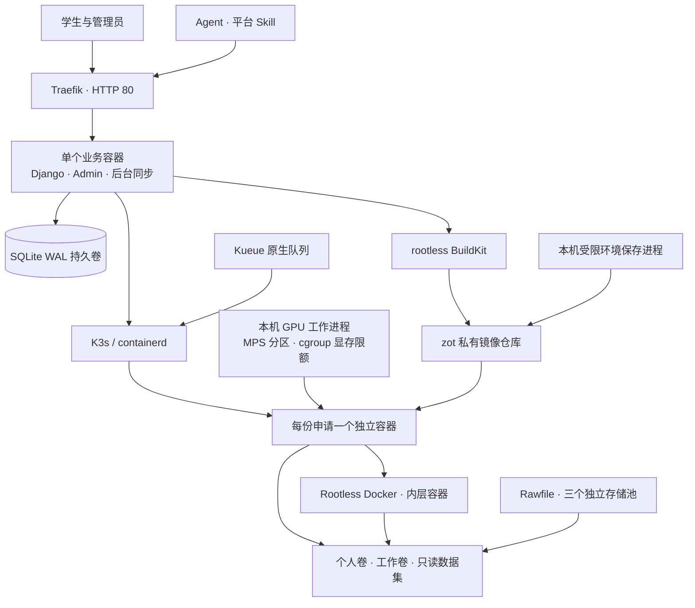
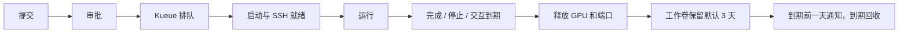

# 架构与功能

平台部署在 ARM64 Ubuntu GPU 服务器上。我们维护一个业务镜像 `gpu-platform:0.2.0`，在 K3s 中运行一个应用 Pod。镜像内包含 Django 用户门户与统一管理界面、Gunicorn、数据库初始化，以及状态同步和回收进程。

## 组件职责

| 组件 | 职责与持久化 |
| --- | --- |
| Django 工作台 | 账号、公钥、用户组配额、申请、审批、延期、停止、镜像回收和审计 |
| SQLite WAL | 保存业务数据；30 秒 busy timeout，短事务使用 `BEGIN IMMEDIATE`；单实例应用 |
| 后台同步 | 对齐 Pod/Job/PVC/Service，更新真实资源与卷用量，执行到期和保留期回收，同步构建结果 |
| K3s / containerd | 调度与容器执行，CPU/RAM/GPU 请求和限制，Secret/PVC 挂载及 NodePort |
| Kueue | 每用户 LocalQueue/ClusterQueue，全局资源借用，原生并发数限制和自动准入 |
| 本机 GPU 工作进程与 Toolkit | 原子分配多张物理卡、动态 MPS SM 分区、设备注入与原生 cgroup 显存限额 |
| OpenEBS Rawfile | 在现有数据盘上为每个 PVC 创建独立 loop-backed 文件系统，执行容量硬限制 |
| zot + rootless BuildKit | TLS 与仓库鉴权，按用户隔离镜像，Dockerfile 构建、推送、digest 和日志 |
| Traefik | 门户入口；当前使用 HTTP，配置支持切换 HTTPS |
| 独立 Rootless Docker | 默认 Ubuntu 22.04 镜像内置；内层容器共用外层额度，镜像、缓存及内部卷保存到 `/workspace/.docker` |

`supervise.py` 管理 Web 和同步两个子进程。业务子进程异常退出后，应用容器退出并由 Kubernetes 重启。健康检查同时检查 Web 和同步心跳。

## 申请和队列

审批事务校验用户组资源配额和卷预算，预留卷容量、固定镜像 digest，并创建唯一 Workspace。重复审批和同步使用相同对象名与所有权标签。每位用户的 Kueue 队列通过 cohort 借用全局 CPU、内存、GPU 和临时存储配额；不可借出的 `pods` 配额限制并发数。获批任务可继续排队等待资源。

门户资源汇总取自 Kubernetes Node Allocatable 和已绑定 Pod 的资源 requests。个人卷用量来自 kubelet 的只读 `nodes/stats`。学生按张数申请 GPU；资源时间轴显示实际 GPU 卡、CPU、内存和预约区间。具体 GPU UUID 由本机工作进程采集并回写受控注解。

NVIDIA Device Plugin v0.17.4 负责具体 GPU 选择，通过 `GetPreferredAllocationAvailable` 调用厂商的 `go-gpuallocator`，按 best-effort 策略优选多卡组合。参考 [插件实现](https://github.com/NVIDIA/k8s-device-plugin/blob/v0.17.4/internal/plugin/server.go) 与 [设备选择逻辑](https://github.com/NVIDIA/k8s-device-plugin/blob/v0.17.4/internal/rm/nvml_manager.go)。

交互任务使用带 Kueue admission gate 的普通 Pod，按选择的开始和结束日期运行，未到开始时间不创建计算对象，到结束时间停止。命令任务使用初始 suspended 的 Job，`backoffLimit: 0`，不设置运行时间 deadline。runner 启动 SSH 和前台主命令、转发停止信号、记录日志与退出码。退出 0、退出 42 和人工取消均已实测。SSH 断开后主命令继续执行。

派发前持久化 dispatch 标记。已派发对象缺失时记录失败供管理员检查，防止程序重复执行。结束结果先写入数据库，再删除计算对象和 Service，确认资源消失后释放端口。

## 存储

三盘分别保持独立文件系统，网页显示统一可分配空间。每个卷落在一块实际可容纳它的磁盘上。

| 内容 | 容器路径 | 生命周期 |
| --- | --- | --- |
| 每人一个个人卷 | `/home/<网站用户名>` | 同账号任务共享，长期保留，可由管理员扩容 |
| 每申请一个工作卷 | `/workspace` | 任务独立，结束后默认保留 3 天，到期前一天通知；保留时间可在管理设置中调整 |
| 公共数据集 | `/datasets` | 管理员维护，学生只读 |
| 平台数据库 | 应用内部 PVC，10 GiB | 升级和默认卸载保留 |
| 镜像仓库 | 独立 PVC，300 GiB | 单独预算和持久化 |

新卷使用 `thinProvision=false`、ext4 `nodiscard,assume_storage_prezeroed=1` 和 `nodiscard` 挂载。预清零选项仅用于 Rawfile 新建的零初始化文件。三盘各 1 GiB 测试卷在写入前保留 1,073,745,920 字节物理块，写满返回 ENOSPC，重挂载 marker 完整。

审批检查逻辑预留、实时空闲、待绑定卷及至少 5% 缓冲。系统卷所在池另从用户可分配容量中预留数据库与仓库预算，共 310 GiB。已有平台卷保持原有内容。满池切换到其他独立池的业务验证通过。

## 镜像与 SSH

首次安装使用打包在业务镜像中的 Dockerfile 和 runner，通过 rootless BuildKit 自动构建共享 Ubuntu 22.04 镜像，镜像源可配置。用户提交 Dockerfile 与可选 HTTPS Git 上下文，结果进入本人的私有仓库并记录大小、digest 和日志。实际私有镜像 GPU 启动、软件保留及跨用户拒绝读取/覆盖通过。

用户可从运行中的开发环境（可带 GPU）提交运行或主动保存镜像。获批后，应用创建受限保存请求，本机 `gpu-platform-node.service` 校验源环境归属，保存容器可写层并推送至私有仓库，清除镜像配置中的 GPU 设备、租约和执行身份。应用确认镜像后停止开发容器。新程序复用个人卷；工作卷大小相同时复用，大小变化时分配新卷，使用无 Kubernetes 凭证的受限复制 Job 离线复制，完整写入并同步后回收原卷。复制失败保留原卷，部分目标卷按保留策略回收。保存失败或运行申请取消时保留源环境。

自动保存的运行快照独立记录临时属性和回收状态。所有任务结束并完成资源释放后才开始计时，成功/取消默认 24 小时，失败默认 72 小时。待审核任务也持有镜像引用。回收领取与申请提交使用 SQLite 原子事务串行处理；领取时取消镜像可用标记，再删除仓库标签，失败可重试。镜像记录以已回收状态保留，继续支持历史任务查询。保留操作可以将运行快照转为长期镜像。

镜像回收使用独立的仅删除仓库身份，账号停用后仍可完成回收。Zot 按标签删除版本，并按 1 小时间隔清理超过 1 小时的无引用内容层；其他标签引用的内容继续保留。节点工作进程继续处理环境保存，仓库回收由应用同步进程执行。

每任务独立 SSH NodePort，范围 30022–30121。公钥认证、禁用密码和 root 登录，支持 scp/sftp、TCP forwarding 和 VS Code Remote-SSH。实际 ARM64 VS Code 1.105.1 / Remote-SSH 0.120.0 已建立管理与远程扩展连接。用户容器以 UID/GID 1000 启动，支持容器内 sudo，使用常规 Docker 默认 capabilities 与专用工作容器策略。

“管理 → 容器”统一列出全体用户容器，支持筛选和 SSH 接入。任务 Secret 包含所属用户与启用中管理员的启用公钥；同步进程持续更新这一字段，OpenSSH 在新连接时读取。管理员使用目标容器用户名和自己的密钥进入，角色和公钥变化同时作用于已有运行容器。网页与 API 共用容器查询及身份权限逻辑，私钥保留在管理员设备。

## 运维与交付

数据库备份功能按用户要求移除。业务数据、用户卷、仓库和 K3s 状态各自持久化。

统一入口发现架构、GPU、CPU、内存、现有磁盘和运行时，部署锁定版本依赖。`platform.app_image_archive` 可直接导入业务镜像归档。ARM64/AMD64 新地址、双池及不同 SSH 范围的入口模拟通过；默认基础镜像真实构建、GPU 和 SSH 启动通过。业务镜像已在 ARM64 实机验证，AMD64 配置已模拟。

公网 HTTP 80、SSH 30022–30121 已获授权。公网接口限制 API 6443、kubelet 10250 和 Flannel UDP 8472；数据库、镜像仓库及 containerd socket 用于内部访问。K3s 服务依赖配置的数据盘挂载路径。升级、回滚、扩容、环境保存及维护命令见运维文档。

默认共享工作镜像统一为 Ubuntu 22.04，包含 SSH、sudo、网络与编译工具、bubblewrap、htop、bash-completion、ble.sh Bash 高亮以及 Docker、Compose、Buildx 和 NVIDIA CDI 工具。Python、CUDA、Conda 与框架由用户按需安装。首次挂载个人卷时补齐 Bash 配置。启动程序使用 Bash，业务应用继续使用独立 Python 镜像。所有日期按北京时间显示，数据库按 UTC 保存。

## 用户组与公用目录

`UserGroup` 保存组名、默认组标记和每位成员的资源上限，`UserProfile.group` 通过外键关联用户组。删除组时可迁移成员，目标组必须容纳成员现有个人卷额度；默认组切换和成员迁移在同一数据库事务内完成。安装初始化只在没有组时创建种子组，后续启动保留管理员的增删结果。

用户组支持 `unlimited` 标记。“管理员”组启用资源不限额，新管理员在初始化时加入该组。不限额组的 GPU、CPU、内存、工作卷、个人卷、镜像、并发任务数和开发环境时长配额均保存为空值，API 省略这些字段；切回限额组时需重新填写。Kueue 用户队列不设置借用上限和并发槽位，实际分配受全机资源池约束。个人卷按所选容量创建或扩容。普通组使用各自配额。

`Workspace.gpu_devices` 保存实际分配的 GPU UUID，`gpu_allocations` 保存每卡 SM 数量、申请和实际算力百分比、显存与分区身份。

## GPU 共享与多卡

每次申请选择 GPU 数量，在逐卡表格中独立设置算力百分比和显存 GiB；数据保存为 `ResourceRequest.gpu_requests` 数组。支持第一张 100%、第二张 50% 等不同规格组合，组配额和 Kueue 请求按所有行求和。配置顺序对应 CUDA 设备顺序，物理卡由调度器整体匹配。四张 RTX 4090 D 各有 114 个 SM；50% 申请分配 56 个 SM，25% 分配 28 个 SM，100% 分配全部 114 个 SM。SM 按 2 个取整，实际分配由任务详情和 API 返回。百分比表示 SM 份额，具体程序吞吐还取决于显存带宽和计算特征。

Kueue 使用 `gpu.platform/compute` 和 `gpu.platform/memory-mib` 两项资源，分别计入算力百分点和总显存。组内每位成员的总算力额度由 `gpu_compute_percent` 直接按百分比设置，例如 150 允许一张全卡加一张半卡；总显存由 `gpu_memory_gib` 设置。`gpu_compute_per_card_percent` 与 `gpu_memory_per_card_gib` 分别限制每张申请卡的算力和显存。不限额组的两项额度均为空。

任务准入后，节点工作进程在每张物理卡上同时检查剩余算力和显存，一次预留全部目标卡。资源不足时保留 GPU 调度门，整项任务排队。可满足时按任务创建 MPS 静态 SM 分区，并将私有 namespace 在服务端绑定到对应分区；其他任务可以持续运行。容器启动前，OCI 钩子校验 Pod 身份和私有租约，设置每卡 cgroup 显存硬上限。任何一步失败会释放本次分配。

每张 GPU 使用 EXCLUSIVE_PROCESS 模式；只有主机 MPS 服务持有计算上下文。用户仅能访问自己的 MPS 接入目录。节点进程向 Pod 注入分配的 UUID；内层 Docker 的 CDI 自动传递同一接入目录。任务所有进程共用对应 SM 分区和逐卡显存上限，内层 Docker 继续使用外层 cgroup。停止后等待计算容器退出，再删除 namespace、SM 分区和租约。主机 MPS 服务独立于节点工作进程，常规工作进程重启保留现有分区；服务异常会结束受影响任务并回收资源。

GPU 租约位于 `/var/lib/gpu-platform/gpu/leases`，访问令牌只允许主机 root 读取；接入目录和日志位于同级 `pipes`、`logs`。systemd 单元为 `gpu-platform-mps.service`。网页、`GET /gpus`、资源概览与时间轴使用同一份逐卡分配数据。

门户新增公用目录只读挂载，路径为 `/srv/platform/datasets`，容器内用户继续通过 `/datasets` 使用同一数据源。网页目录逐级通过文件描述符和 `O_NOFOLLOW` 打开，目录遍历和符号链接不能越过浏览根目录；文件下载采用附件响应和流式读取。文件上传由服务器 SSH 完成。

管理员可在存储页删除空闲的个人卷与工作卷。删除流程检查任务、环境保存及实际挂载，先删除归属匹配的 PVC，再等待底层 PV 消失，最后释放预留额度。删除中的卷阻止新申请使用；个人卷删除后，后续任务可创建新的个人卷。

资源视图由主机 LXCFS 5.0 提供，通过只读 Local PV/PVC 挂入用户容器的 proc 和 CPU online 信息。原始 cgroup CPU/内存硬限制继续由 K3s 执行。容器启动时将 UID/GID 1000 对应账号初始化为任务冻结的网站用户名，保留数值 UID 以延续个人卷文件权限。SSH、公钥读取账号、HOME、个人卷挂载和命令工作目录共同使用此身份。

## API 与 Agent

`/api/v1/` 提供与网页共用权限、表单和服务层的 JSON API，覆盖资源申请与审批、任务连接与日志、停止和保存、镜像构建及回收、卷、公用目录和管理操作。网页「API 访问」生成个人令牌，并提供 OpenAPI 与可下载 skill。令牌复用现有会话表，密码或账号状态变化后失效；接口无需新增数据库结构。

项目业务表按当前模型初始化，不保留 portal 迁移文件和历史迁移记录。具体接口与 Agent 用法见 [API 文档](api.md)。
