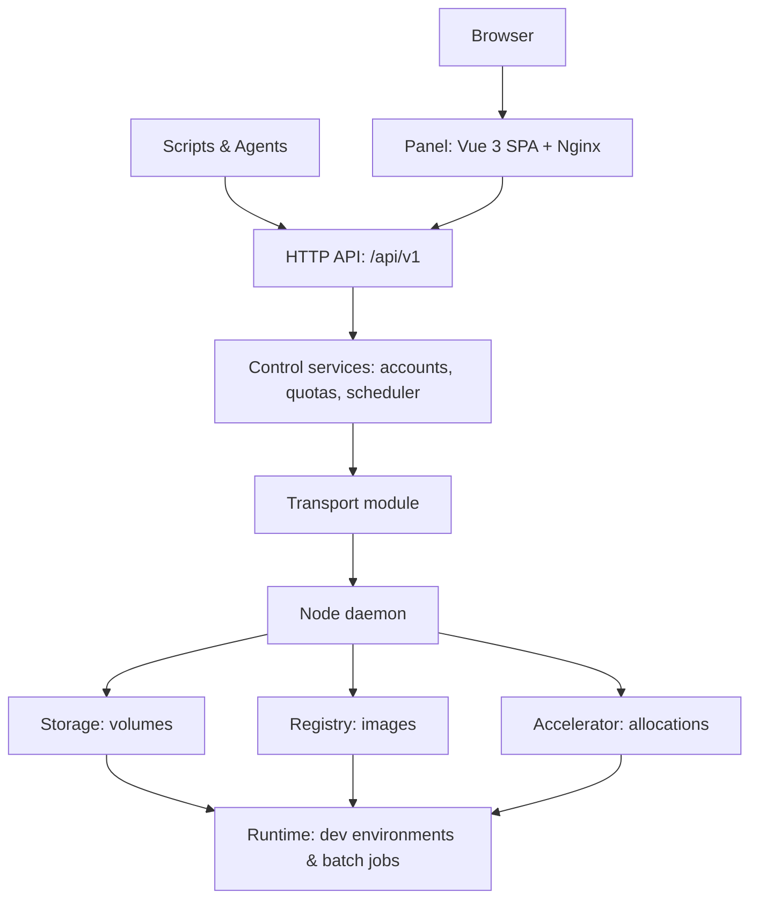

# Architecture

[Home](../../README.md) · [简体中文](../zh/architecture.md)

The control service manages accounts, quotas, approvals, scheduling, and task lifecycles behind the `/api/v1` HTTP API. The standalone Vue 3 panel consumes that API from its own Nginx container, and each execution node turns approved tasks into running environments using its configured modules.

## Workspace packages

| Package | Stack | Responsibility |
| --- | --- | --- |
| `packages/contracts` | Python (Pydantic) | Slot interfaces, handoffs, resource definitions, messages, reusable contract test suites |
| `packages/control` | Python (Django + Django Ninja) | Accounts, approvals, quotas, scheduling, retention, sync, metrics history, `/api/v1` HTTP API |
| `packages/panel` | TypeScript (Vue 3 + Vite + Tailwind CSS v4 + Reka UI) | Standalone SPA served by Nginx, calling `/api/v1` with cookie sessions + CSRF |
| `packages/node` | Python | Commands, module orchestration, capability/metric reporting, local expiry, dataset streams |
| `packages/installer` | Python | Cluster config validation, host setup, module install ordering, Docker Compose generation |
| `modules/<slot>/<implementation>` | Python | Concrete infrastructure implementations loaded via entry points |

Control, node, and installer discover concrete implementations through `gpu_platform.slots.<slot>` entry points and depend only on `contracts`. `import-linter` enforces Python package boundaries.

## Modules and handoffs

Each server selects its own implementations across ten slots (for example NVIDIA MPS, Ascend 310P, or CPU-only with `gpu: null`). Modules exchange typed handoffs (volumes, images, accelerator allocations, snapshots, port connections, and byte streams). The installer validates that every provider and consumer agrees before installing. See the [module guide](modules.md) for details.

## Single server to multi-server cluster

One `cluster.yaml` file defines `cluster`, `defaults`, `control`, and `hosts`. Host overrides merge on top of `defaults`; `null` disables a slot. Combined control+node hosts use local Unix-socket transport automatically, while remote execution servers select transport (`reverse-ssh`) and login-entry (`controller-forward`) modules.

Each host runs a generated Docker Compose stack:

- **Control host**: `panel` (Nginx serving static assets on `web_port` and reverse-proxying `/api/` and `/healthz` to internal `web:8000`), `web`, `loop`, `links`, and `notifier` (when configured).
- **Execution host**: `node` and module services such as `registry` and `builder`. The K3s runtime module configures K3s and LXCFS on the host.

All persistent state—database, keys, metrics history, allocation ledgers, registry storage, and user volumes—lives on host-mounted directories.

## Request lifecycle

1. The panel or API queries the target server's capabilities and submits a request to `/api/v1/tasks`.
2. Control validates permissions, quotas, approval policy, and reservations across all servers.
3. Once approved and scheduled, control dispatches the task to the execution node.
4. The node prepares volumes, verifies the image, allocates accelerators, and starts the workload via the runtime module.
5. The login-entry module publishes SSH connection info; the node reports status and hardware load.
6. When the task completes, stops, or expires, compute resources release immediately while work volumes and temporary images follow retention rules.

Maintenance mode blocks new requests while letting running tasks finish. Disconnected execution nodes continue supervising active tasks and stop expired dev environments locally; control preserves ownership and reservations while reconnecting.

Tasks, images, home volumes, and work volumes belong to their server. Image synchronization creates an independent copy on another server of the same CPU architecture, while home and work volumes stay local to each server.
