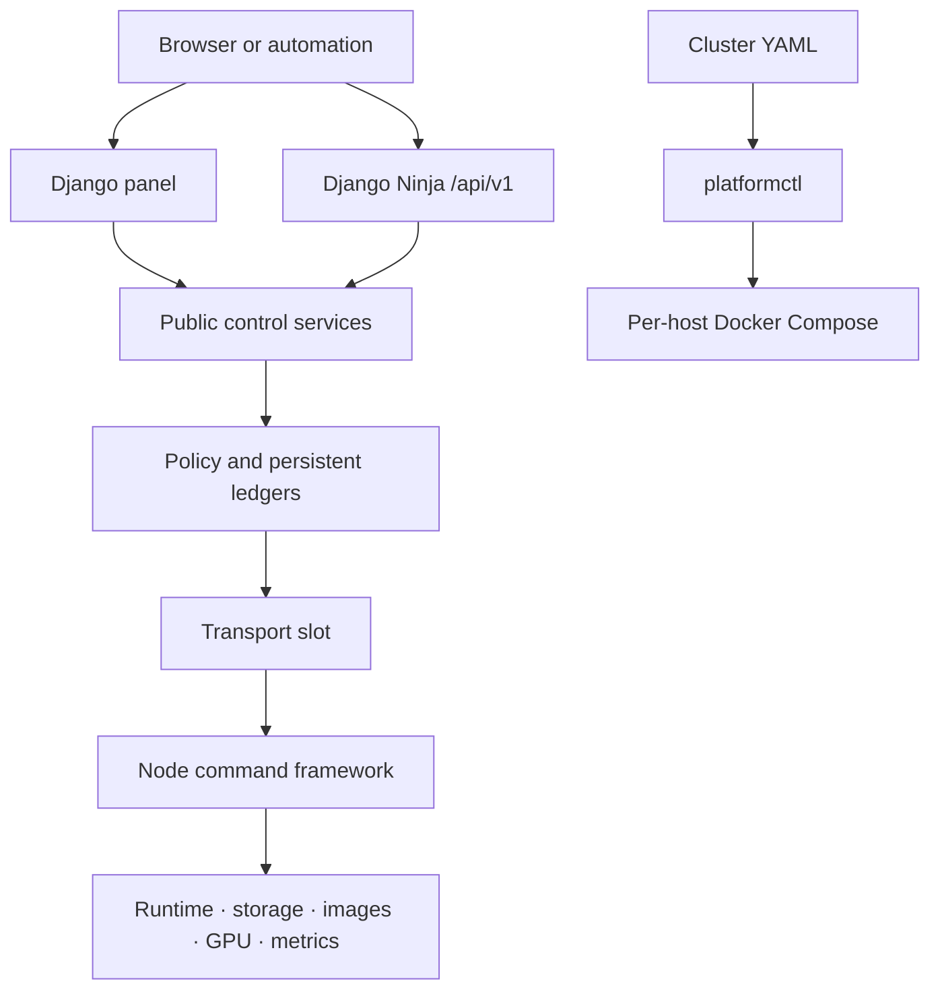

# Architecture

The platform separates policy, presentation, and machine execution. The control service owns accounts, approvals, resource ledgers, task dispatch, retention, synchronization, and event records. The panel calls its public service layer. Nodes receive versioned commands and assemble executable environments from module handoffs.

## Packages and boundaries

| Package | Responsibility | Dependencies within the workspace |
| --- | --- | --- |
| `contracts` | Pydantic schemas, ten slot interfaces, handoffs, messages, reusable test suites | Pydantic |
| `control` | Django models, business services, HTTP API, reconciliation and notification loops | Contracts |
| `panel` | Templates, browser interactions, public-service adapters | Control public services |
| `node` | Command routing, capability reports, local expiry, datasets and data streams | Contracts |
| `installer` | Configuration merging, compatibility checks, installation order, Compose | Contracts |
| `modules/<slot>/<implementation>` | One slot implementation and its host assets | Contracts |

Implementations are loaded from `gpu_platform.slots.<slot>` Python entry points. The same discovery mechanism loads built-in and external modules. Import-linter enforces package boundaries.

## Configuration and handoffs

One YAML document contains `cluster`, `defaults`, `control`, and `hosts`. Resolution applies built-in defaults, cluster-wide defaults, then host-specific values. Setting a slot to `null` disables it. A node colocated with the control service receives local transport and local login entry automatically.

Modules declare the handoff forms they provide and accept. Storage provides volumes; registries provide images; GPU modules provide allocations; runtimes provide environment snapshots. Build results enter a registry. Transport provides command exchange, port connections, and binary streams. The node supplies read-only public directory handoffs.

Installation validates required slots, form intersections, feature prerequisites, module version compatibility, implementation requirements, and local host checks. Host prerequisite hooks run first. Module installation then follows provider order; removal reverses the order. This allows the runtime to prepare K3s before Rawfile creates its storage infrastructure.

## Resources and task execution

Modules register resource definitions with stable keys and units. The control ledger applies those definitions to quotas and active reservations across nodes. The core also manages concurrency, development duration, and login ports. A custom resource appears in request and quota forms through its registered definition. The canonical ledger stores resource-keyed quantities and allocation groups. Panel-owned forms coerce input; public services validate commands and return materialized records. Core models contain no fixed CPU, GPU, or technology-specific quota columns.

A task command specifies identity, ownership, resources, image, volumes, expiry, and execution intent. The node obtains volumes, an image, and GPU allocations, then passes them to the runtime. The runtime generates its own execution objects. Standard development environments provide SSH and VS Code access, personal and working directories, Docker, and resource views matching the assigned limits.

The node protocol uses `queued`, `starting`, `running`, `ended`, and `failed` task states. Approval and preparation records belong to the control workflow. Maintenance mode prevents new dispatch. A disconnected node continues supervising existing tasks and stops expired environments locally. The controller retains ownership and reservations while a node is unreachable.

## Images and synchronization

Tasks, volumes, images, and builds belong to a node. Image synchronization creates an independent copy on another node of the same CPU architecture. The control service checks access and image quota, reserves the destination bytes, records progress, and dispatches export and import commands. Members can synchronize only their own private images. The private copy counts toward the owner's cluster-wide quota. Administrators synchronize shared images with shared destination copies and can synchronize public data.

Public data synchronization applies a source directory tree to configured targets. It supports periodic policies, manual administrator requests, relative subtree selection, and bandwidth limits. Target copies follow the source. Personal and working directories remain node-local.

`save_environment`, `public_datasets`, `image_sync`, and `dataset_sync` are configurable features. Synchronization is inactive with one execution node. Images and snapshots continue through their retention lifecycle independently after synchronization.

## Processes and persistence

The control image supplies `web`, `loop`, and `links` services in both single-host and multi-host deployments, plus optional `notifier`. The `links` service maintains local and remote task login routes; transport modules add their own keys and proxy settings. Each execution host runs one `node` container, plus module services such as `registry` and `builder`. The node uses host networking and process visibility. K3s and LXCFS run as host infrastructure owned by the runtime module.

Persistent state uses host-mounted directories: database, account secrets, node sockets, image metadata, runtime records, and GPU leases. Data volumes use configured disk pools. Rebuilding a container reuses those directories.

Events and node errors carry a code and parameters. The control service selects the recipient or viewer language. English is the source language. Simplified Chinese catalogs supply translated panel and JavaScript messages. The panel uses the account's saved language preference, or the browser language when the account has no preference.
