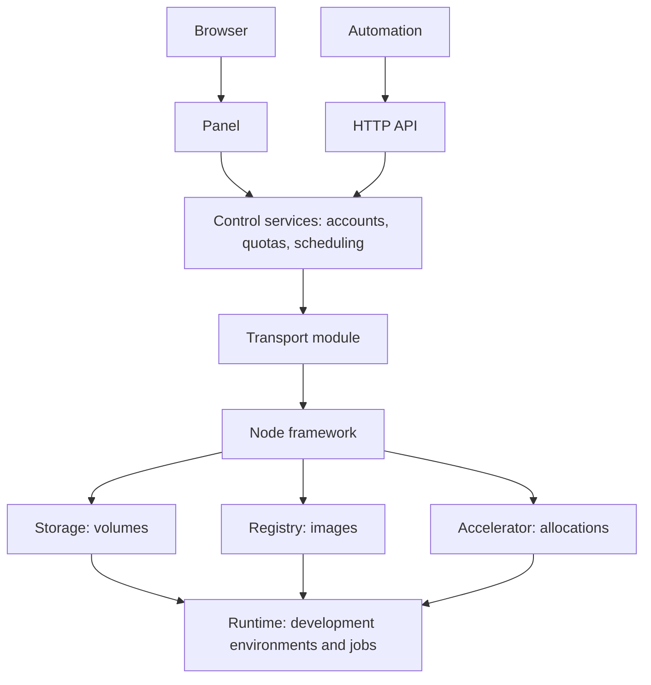

# How the platform fits together

[Home](../../README.md) · [简体中文](../zh/architecture.md)

The control service manages users, quotas, approvals, and task lifecycles. Each node turns an approved request into a working environment using its selected modules. The panel and API share the same business services.

## Modules make deployment choices local

A node can use NVIDIA MPS, Ascend 310P, or CPU resources. Authentication, storage, runtime, and the other slots have their own interfaces. External implementations register under `gpu_platform.slots.<slot>` and depend on the contracts package plus their own libraries.

Modules exchange typed objects called handoffs: volumes, images, accelerator allocations, snapshots, port connections, and streams. The installer checks that the chosen providers and consumers agree. [Module development](modules.md) explains how to add an implementation.

| Package | Responsibility |
| --- | --- |
| `contracts` | Slot interfaces, handoffs, resource definitions, messages, reusable test suites |
| `control` | Accounts, approvals, resource ledgers, dispatch, retention, synchronization, API |
| `panel` | Pages and forms calling public control services |
| `node` | Commands, module orchestration, reports, local expiry, public data streams |
| `installer` | Configuration, checks, host setup, installation order, Compose generation |
| `modules/<slot>/<implementation>` | Infrastructure implementation and its host assets |

Control, node, and installer use contracts to discover implementations. Concrete infrastructure stays in modules. Import-linter checks these boundaries.

## From one server to several

One YAML file contains `cluster`, `defaults`, `control`, and `hosts`. Host overrides follow cluster defaults; `null` disables a slot. A combined control and execution host uses local communication automatically. Remote nodes select transport and login-entry modules.

Each host gets a generated Docker Compose deployment. The control image runs `web`, `loop`, and `links`, plus `notifier` when configured. Execution hosts run `node` and module services such as `registry` and `builder`. The K3s runtime prepares K3s and LXCFS on the host. Databases, keys, allocation records, and data volumes use persistent host storage.

## What happens to a request

1. The panel or API reads the target node's capabilities and submits a request.
2. Control checks permissions, approval policy, quotas, and reservations across nodes.
3. The node prepares volumes, an image, and accelerator allocations; the runtime queues and starts the task.
4. The login module supplies SSH connection details. The node reports status and usage.
5. On completion or expiry, resources are released and storage and images follow retention settings.

Maintenance mode stops new dispatch. A disconnected node continues supervising existing tasks and stops expired development environments locally. Control retains the task's ownership and reservations while reconnecting.

Tasks, images, and volumes belong to a node. Image synchronization creates an independent copy on a node of the same CPU architecture; private copies count toward their owner's image quota. Public-directory synchronization follows the selected source tree. Home and work volumes stay local to each node.
