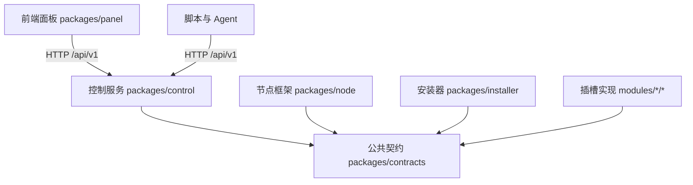

# 架构约定

[系统架构](architecture.md) · [English](../en/architecture.md) · [模块指南](modules.md)

本文档定义仓库内各包之间的依赖边界与扩展契约。

## 包与依赖边界

Python 包之间的边界由 `import-linter` 强制检查；前端面板位于独立的 TypeScript 工作区 `packages/panel`，通过 `/api/v1` OpenAPI 契约与控制服务交互，不导入任何 Python/Django 内部模块。

| 包 | 职责 | 依赖 |
| --- | --- | --- |
| `packages/contracts` | 数据模型、十个插槽接口、交接物、资源定义、协议与可复用测试套件 | Pydantic |
| `packages/control` | 账号、审批、配额、任务与端口账本、派发、保留策略、同步、审计与 `/api/v1` API | `contracts` |
| `packages/panel` | 独立 Vue 3 + TypeScript + Vite 前端面板（Nginx 容器托管） | `/api/v1` HTTP 契约 |
| `packages/node` | 指令执行、模块编排、能力上报、本地到期停止与共享数据集流 | `contracts` |
| `packages/installer` | 配置解析、兼容性校验、安装顺序编排、主机准备与 Compose 生成 | `contracts` |
| `modules/<slot>/<implementation>` | 基础设施具体实现及其主机资产 | `contracts` 及自身实现依赖 |

## 十个扩展插槽

所有 Python 模块通过 `gpu_platform.slots.<slot>` entry points 注册：

| 插槽 | 职责 | 内置实现 |
| --- | --- | --- |
| `auth` | 验证身份凭据并返回稳定外部身份 | `local` |
| `transport` | 带版本节点指令、在线检查、有界数据流与双向端口转发 | `local`、`reverse-ssh` |
| `entry` | 建立、描述与关闭开发环境 SSH 入口 | `local`、`controller-forward` |
| `runtime` | 排队、启动、监管、停止与保存容器环境，执行 CPU 与内存限制 | `k3s` |
| `storage` | 创建、扩容、复制、删除卷并上报已用空间 | `rawfile` |
| `registry` | 按归属存储镜像、容量记账、导出与导入 | `zot` |
| `build` | 构建排队、资源限制、取消、日志与结果产出 | `buildkit` |
| `gpu` | 加速卡发现、评估、分配、隔离与释放 | `nvidia-mps`、`ascend` |
| `metrics` | 带采样时间的硬件监控指标 | `host` |
| `notify` | 向站内或外部渠道投递事件通知 | `inapp`、`pushplus` |

认证、运行与存储为必选插槽；远程节点需配置通信和登录入口；通知插槽支持同时启用多个模块。

## 资源记账、交接物与生命周期

- 模块通过稳定资源键、单位、上下限与记账类别注册资源。控制服务按资源键和分配组持久化额度并检查跨服务器总量，保持核心模型独立于具体硬件类型。
- 存储、仓库、加速卡、运行环境、构建和通信模块通过类型化交接物衔接，安装器按提供方顺序执行安装、反序执行卸载，并通过 `HostOwnership` 记录自有变更以保证卸载时保留用户数据与已有基础设施。
- 控制服务维护 `submitted`、`scheduled`、`preparing`、`queued`、`starting`、`running` 及终态；节点在断线期间继续监管本地容器并按时停止到期开发环境。
- 新部署直接创建当前数据库结构，仓库不保留 Django 迁移历史与旧部署兼容适配层。

## 语言、浏览器基线与验证

- 用户可见源文案使用英文并提供简体中文翻译；Agent skill、安装器输出、日志与配置注释使用英文。
- `packages/panel` 面向现代常青浏览器（最新版 Chromium、Firefox、Safari），优先使用原生 CSS/HTML 特性（`light-dark()`、`color-mix()`、`<dialog>`、Popover API、Container Queries），不引入旧版浏览器兼容垫片。
- 测试覆盖可观察行为、API 与插槽契约、资源记账、授权、状态转换与失败处理；断言面向行为与结构化数据，不以文案、翻译或页面文本快照为测试目标。
- 不向仓库提交验证报告或临时笔记；本地检查命令见[开发指南](development.md)。
