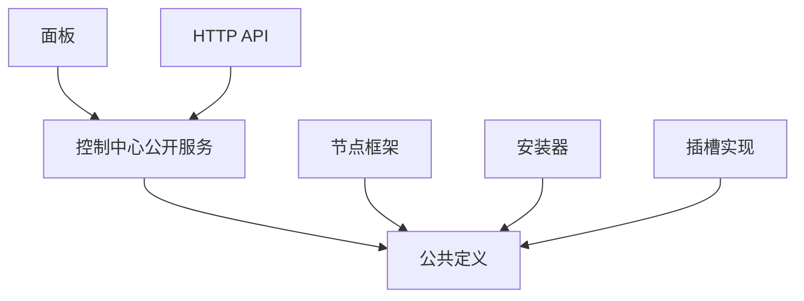

# 架构约定

[架构概览](architecture.md) · [English](../../gpu-platform-architecture.md) · [模块指南](modules.md)

本文规定包之间的依赖边界与扩展契约。[README](../../README.zh-CN.md)介绍部署场景，这里用于指导实现。

## 包与依赖

箭头表示代码依赖。控制中心、节点和安装器通过 Python entry points 发现具体模块。

| 包 | 职责 | 工作区依赖 |
| --- | --- | --- |
| `contracts` | 数据定义、十个插槽、交接物、资源定义、协议和可复用测试套件 | 无；外部依赖为 Pydantic |
| `control` | 账号、审批、配额、任务与端口账本、派发、保留策略、同步、审计和 API | Contracts |
| `panel` | 页面、表单和浏览器交互 | Control 公开服务 |
| `node` | 指令、模块编排、能力报告、到期停止和公共目录数据流 | Contracts |
| `installer` | 配置解析、检查、安装顺序、主机准备和 Compose 生成 | Contracts |
| `modules/<slot>/<implementation>` | 插槽实现及其基础设施资源 | Contracts |

模块依赖公共定义及自身所需的库，运行、存储、网络、镜像仓库和加速卡的具体实现在模块内。面板调用公开服务，由服务验证命令并返回已求值的结果。Import-linter 检查依赖边界。

## 十个扩展插槽

实现通过 `gpu_platform.slots.<slot>` 注册，完成所选接口的全部职责。

| 插槽 | 职责 | 内置实现 |
| --- | --- | --- |
| `auth` | 验证凭据，返回提供方与稳定身份 | `local` |
| `transport` | 带版本指令、在线检查、有界数据流与双向端口连接 | `local`、`reverse-ssh` |
| `entry` | 建立、描述与关闭任务登录路径 | `local`、`controller-forward` |
| `runtime` | 排队、启动、监督、停止和保存环境与程序，限制 CPU 和内存 | `k3s` |
| `storage` | 创建、调整、复制、删除卷并报告用量 | `rawfile` |
| `registry` | 按归属存储镜像、记账、导出和导入 | `zot` |
| `build` | 构建排队、资源限制、取消、日志与结果 | `buildkit` |
| `gpu` | 加速卡发现、评估、分配、限制和释放 | `nvidia-mps`、`ascend` |
| `metrics` | 带采样时间的硬件读数 | `host` |
| `notify` | 向配置的接收者发送事件 | `pushplus` |

认证、运行和存储为必须插槽。远程节点需配置通信和登录入口，同机节点自动使用本机实现。仓库、构建、加速卡、监控和通知按功能依赖选择，通知可同时启用多个模块。

## 标准环境与资源记账

每种运行模块都提供 SSH 与 VS Code 连接、任务用户身份、持久个人卷和工作卷、环境内 Docker，以及与分配额度相符的资源视图。启用公共数据时以只读方式挂载。

模块使用稳定键、单位、数量限制、汇总范围与记账类别登记资源。控制中心按资源键和分配组保存数量，生成配额与申请字段，检查跨节点总量。核心模型独立于具体资源类型，同时管理并发数、环境时长和登录端口。

NVIDIA 共享和 Ascend 整颗芯片分配属于模块策略，模块提供记账换算、限制与说明。新增资源类型使用同一套登记机制。

## 交接物与生命周期

存储提供卷，仓库提供镜像，加速卡模块提供分配，运行模块提供快照，构建返回可导入仓库的结果。节点提供只读公共目录，通信模块提供连接与数据流。各实现声明可提供和接收的形式。

安装器检查必须插槽、版本、形式交集、功能依赖、模块要求与主机条件。主机前置钩子先运行，模块按提供方顺序安装，反序卸载。安装交接物传递仓库信任和加速卡运行设置。需要常驻服务的模块提供 Compose 服务与挂载片段。

操作使用稳定标识，验证归属，重试避免重复分配。主机所有权日志记录新建资源与可撤销配置变更，卸载移除模块拥有的资源，保留用户数据、已有基础设施和管理员修改。

## 控制中心与节点行为

控制中心管理策略、审批、预留、保留规则和派发。指令描述执行意图、身份、资源、镜像、卷和截止时间。节点组合交接物，由运行模块生成具体执行对象。

节点执行状态为 `queued`、`starting`、`running`、`ended`、`failed`；审批与准备属于控制中心。协议包含明确版本，不兼容节点停止接收新工作。维护模式阻止派发。断线节点继续监督已有任务并在本地停止到期环境，控制中心在等待重连期间保留归属和资源预留。

任务、卷、镜像和构建都有所属节点。镜像同步要求 CPU 架构相同，生成独立保留的副本；私有副本和待完成预留计入所有者配额。成员同步自己的私有镜像，管理员还可同步共享镜像和公共数据。公共目录同步把源变更应用到选定目标子目录，个人卷与工作卷保留在各节点。

## 配置与部署

一份 YAML 包含 `cluster`、`defaults`、`control`、`hosts`，按内置默认、集群默认、主机覆盖解析。映射合并、列表替换、`null` 关闭插槽。四个功能开关为 `save_environment`、`public_datasets`、`image_sync`、`dataset_sync`。只有一个执行节点时同步停用。

平台服务使用每台主机的 Docker Compose 部署。控制中心镜像提供 `web`、`loop`、`links` 和可选的 `notifier`。执行主机运行 `node` 与所选模块服务。节点容器使用主机特权访问；K3s、LXCFS 等主机基础设施由对应模块的安装钩子管理。状态和用户数据保存在主机挂载目录与配置的存储池。

升级与卸载要求维护模式且节点任务已排空，执行节点使用新鲜的集群维护报告，并在停机前检查本地守护进程。新部署直接创建当前数据库结构，项目不保留应用迁移历史与旧部署转换适配层。

## 语言与验证

源码使用英文，面向用户的文字提供简体中文翻译。面板在账号保存偏好前跟随浏览器语言。API 提示跟随请求语言，通知跟随接收者语言，审计按查看者语言显示。协议消息保存代码与参数。Agent skill、安装器输出、日志和配置注释使用英文。

可复用插槽套件与功能测试验证可观察行为、契约、资源记账、授权、状态转换、并发和失败处理。fixture 与注入依赖使检查独立于部署和机器。修复后使用已有功能测试和直接检查。文案、翻译、文字快照和旧功能保留不作为测试目标。

生成资源、临时笔记与验证报告不放入仓库，验证结果在对话中报告。本地命令见[开发指南](development.md)。
