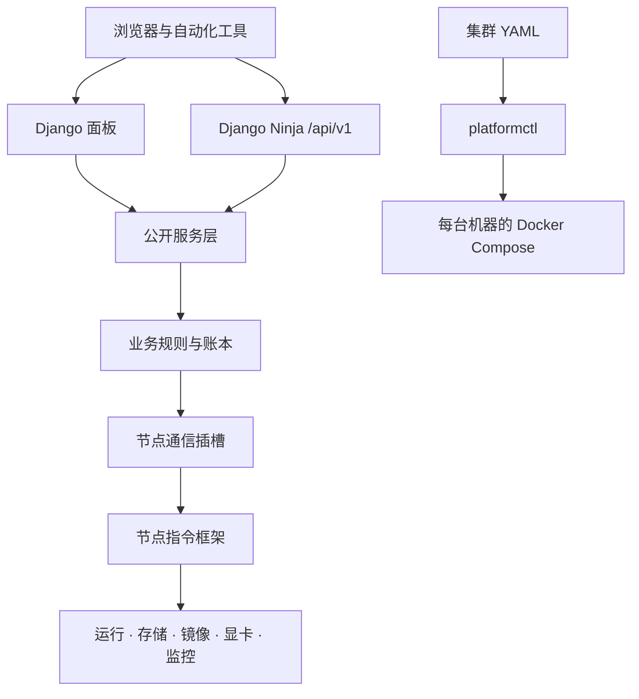

# 系统架构

控制中心管理账号、审批、资源账本、任务派发、保留策略、同步和审计。面板调用控制中心的公开服务层。节点接收带版本号的指令，通过模块交接物组合执行环境，并在本机生成运行配置。

## 包与分层

| 包 | 职责 | 仓库内部依赖 |
| --- | --- | --- |
| `contracts` | Pydantic 定义、十个插槽、交接物、消息、可复用测试套件 | Pydantic |
| `control` | Django 模型、业务服务、HTTP API、同步循环、通知循环 | Contracts |
| `panel` | 模板、浏览器交互、公开服务适配 | Control 公开服务 |
| `node` | 指令路由、能力报告、到期自停、公共目录、数据流 | Contracts |
| `installer` | 配置合并、兼容检查、安装顺序、Compose | Contracts |
| `modules/<插槽>/<实现>` | 插槽实现及其主机资产 | Contracts |

模块通过 `gpu_platform.slots.<插槽>` entry points 注册。内置模块和外部模块使用同一套发现机制。Import-linter 检查依赖边界。

## 配置与交接

整个集群共用一份 YAML，包含 `cluster`、`defaults`、`control`、`hosts`。覆盖顺序为内置默认、集群默认、机器覆盖；插槽设为 `null` 后停用。控制中心同机节点自动使用本机通信和本机登录入口。

模块声明能够提供、接收的交接物形式。存储提供卷，仓库提供镜像，显卡模块提供分配结果，任务运行提供环境快照，构建结果交给仓库。通信插槽提供指令、端口连接和二进制数据流。节点框架提供只读公共目录。

安装前检查必须插槽、交接物形式、功能条件、版本、模块组合要求和机器条件。主机基础设施钩子先运行，随后按提供方顺序安装模块，卸载时反序执行。K3s 在主机阶段准备，Rawfile 在模块阶段安装存储设施。

## 资源与任务

模块登记稳定的资源键、单位和显示信息。控制中心将这些定义用于配额、申请和跨节点预留账本；并发数、开发时长和登录端口由核心管理。自定义资源会进入申请与配额表单。账本按资源键保存数量和分配组；面板自己的表单处理输入格式，公开服务验证业务命令并返回已求值的数据。核心模型不包含固定的 CPU、GPU 或技术相关配额列。

任务指令包含身份、归属、资源、镜像、卷、截止时间和执行意图。节点准备卷、镜像和显卡分配，再交给任务运行模块生成执行对象。标准开发环境提供 SSH、VS Code、个人卷、工作卷、Docker 和对应申请额度的资源视图。

节点协议使用 `queued`、`starting`、`running`、`ended`、`failed` 五种任务状态。审批与准备属于控制中心工作流。维护模式停止新派发。断线节点继续管理已有任务并停止到期环境；控制中心保留任务归属和预留记录。

## 同步与持久化

任务、卷、镜像和构建归属节点。镜像同步在相同 CPU 架构的节点间创建独立副本；控制中心先检查访问权和总镜像配额，再预留目标空间、记录进度、下发导出与导入指令。普通用户只能同步自己的私有镜像，共享镜像由管理员同步，目标副本自动保持共享。私有副本计入所有者额度，各副本分别执行保留策略。

公共目录同步将源目录树应用到目标，支持周期策略、管理员手动触发、相对子目录范围和带宽限制。目标副本跟随源目录。个人卷和工作卷保留在所属节点。

四个开关为 `save_environment`、`public_datasets`、`image_sync`、`dataset_sync`。只有一个执行节点时，同步自动停用。

单机和多机部署的控制中心都运行 `web`、`loop`、`links`，并按配置运行 `notifier`。`links` 维护本机和远程任务的登录入口，通信模块补充所需密钥挂载和代理设置。执行机器运行一个 `node` 容器，以及所选模块提供的 `registry`、`builder` 等服务。节点容器使用主机网络和进程空间；K3s、LXCFS 由任务运行模块安装为主机设施。

数据库、密钥、节点套接字、镜像元数据、运行记录和显卡租约保存在主机挂载目录。数据卷使用配置的数据盘池，容器重建后继续使用这些持久数据。

审计事件和节点错误保存代码与参数，控制中心按查看者或接收者的语言显示。英文为源码语言，中文目录提供面板和脚本翻译。面板采用账号保存的语言偏好，未设置时跟随浏览器语言。
