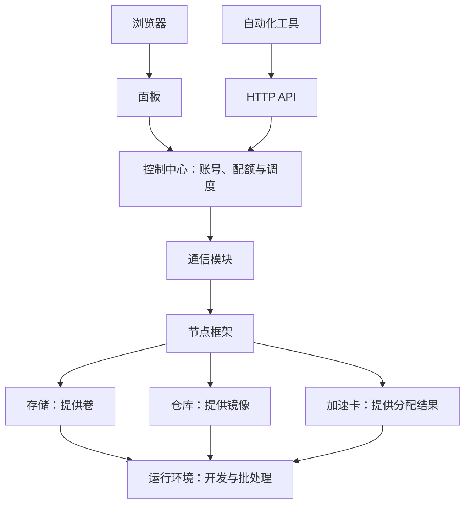

# 各部分如何配合

[首页](../../README.zh-CN.md) · [English](../en/architecture.md)

控制中心管理用户、配额、审批和任务生命周期。节点使用自己选择的模块，把获批申请变成可用环境。面板和 API 共用同一套业务服务。

## 用模块适配部署场景

节点可以使用 NVIDIA MPS、昇腾 310P 或纯 CPU 资源。认证、存储、运行环境等插槽各有明确接口。外部实现通过 `gpu_platform.slots.<slot>` 注册，依赖公共定义包和自身所需的库。

模块通过有类型的交接物配合，包括卷、镜像、加速卡分配、快照、端口连接和数据流。安装器检查提供方与接收方是否匹配。添加实现的方法见[模块开发](modules.md)。

| 包 | 职责 |
| --- | --- |
| `contracts` | 插槽接口、交接物、资源定义、消息和可复用测试套件 |
| `control` | 账号、审批、资源账本、派发、保留策略、同步和 API |
| `panel` | 通过控制中心公开服务提供页面与表单 |
| `node` | 指令、模块编排、状态报告、到期停止和公共数据流 |
| `installer` | 配置、检查、主机准备、安装顺序和 Compose 生成 |
| `modules/<slot>/<implementation>` | 基础设施实现及其主机资源 |

控制中心、节点和安装器通过公共定义发现模块，具体基础设施实现在模块内。Import-linter 检查这些边界。[架构约定](../../gpu-platform-architecture.md)定义项目共同遵循的规则。

## 从单机扩展到多机

集群共用一份 YAML，包含 `cluster`、`defaults`、`control`、`hosts`。主机配置覆盖集群默认值，`null` 关闭插槽。控制与执行合并的主机自动使用本机通信，远程节点选择通信与登录入口模块。

每台主机生成一套 Docker Compose 部署。控制中心镜像运行 `web`、`loop`、`links`，启用通知时增加 `notifier`。执行主机运行 `node`，以及 `registry`、`builder` 等模块服务。K3s 运行模块在主机上准备 K3s 和 LXCFS。数据库、密钥、分配记录和数据卷使用主机持久存储。

## 一次申请的流程

1. 面板或 API 读取目标节点能力，提交申请。
2. 控制中心检查权限、审批策略、配额和跨节点预留。
3. 节点准备卷、镜像与加速卡分配，运行模块负责排队和启动。
4. 登录模块提供 SSH 连接信息，节点持续报告状态和用量。
5. 任务结束或环境到期后释放资源，存储与镜像按保留策略管理。

维护模式停止新任务派发。节点断线后继续管理已有任务，并在本地停止到期开发环境。控制中心在等待重连期间保留任务归属与资源预留。

任务、镜像和卷都有所属节点。镜像同步在相同 CPU 架构的节点间创建独立副本，私有副本计入所有者镜像配额。公共目录同步跟随选定的源目录。个人卷和工作卷分别保存在各节点。
