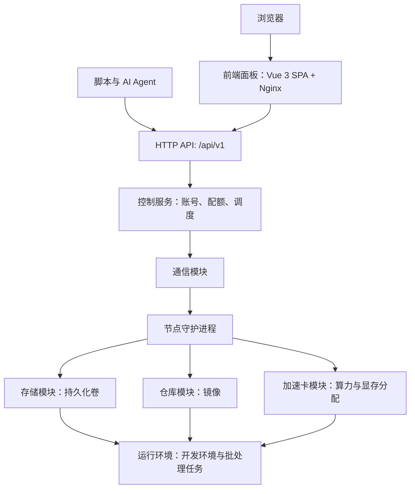

# 系统架构

[返回首页](../../README.zh-CN.md) · [English](../en/architecture.md) · [架构约定](architecture-conventions.md)

控制服务在 `/api/v1` 之后统一管理账号、配额、审批、调度与任务生命周期；独立前端面板作为 Vue 3 单页应用运行在自己的 Nginx 容器中并通过 `/api/v1` 交互；各执行服务器上的节点守护进程按所选模块把已批准的任务启动为实际容器环境。

## 工作区包职责

| 包路径 | 技术栈 | 职责 |
| --- | --- | --- |
| `packages/contracts` | Python (Pydantic) | 插槽接口、交接物契约、资源定义、消息协议与可复用测试套件 |
| `packages/control` | Python (Django + Django Ninja) | 账号、审批、配额、调度、保留策略、数据同步、性能历史与 `/api/v1` HTTP API |
| `packages/panel` | TypeScript (Vue 3 + Vite + Tailwind CSS v4 + Reka UI) | 独立前端单页应用，由 Nginx 容器托管，通过 Cookie 会话与 CSRF 调用 `/api/v1` |
| `packages/node` | Python | 执行指令、模块编排、容量与硬件指标上报、本地到期停止、共享数据集流式读取 |
| `packages/installer` | Python | 集群配置校验、主机环境准备、模块按依赖顺序安装与 Docker Compose 生成 |
| `modules/<slot>/<implementation>` | Python | 各插槽的具体基础设施实现，通过 entry points 注册 |

控制服务、节点框架和安装器只依赖 `contracts`，通过 `gpu_platform.slots.<slot>` entry points 加载具体模块。`import-linter` 持续检查 Python 包边界。

## 模块与交接物

每台服务器按十个扩展插槽独立选择实现（如 NVIDIA MPS、昇腾 310P 或纯 CPU 模式 `gpu: null`）。模块之间通过强类型交接物传递卷、镜像、加速卡分配、环境快照、端口连接和数据流；安装器在部署前自动检查所有提供方与消费方的交接物格式是否匹配。详见[模块指南](modules.md)。

## 从单台服务器扩展到多机集群

一份 `cluster.yaml` 描述 `cluster`、`defaults`、`control` 与 `hosts`。单台主机覆盖项合并在集群默认之上，设置 `null` 即可关闭对应插槽。控制与节点合布在同一主机时自动使用本机 Unix 套接字通信；远程执行服务器配置反向 SSH 通信与入口转发模块。

每台主机运行安装器生成的 Docker Compose 服务栈：

- **控制主机**：`panel`（Nginx 监听 `web_port`，托管静态前端资源并将 `/api/` 与 `/healthz` 反向代理至内部 `web:8000`）、`web`、`loop`、`links` 以及配置通知后的 `notifier`。
- **执行主机**：`node` 以及 `registry`、`builder` 等模块服务。K3s 运行模块负责在宿主机上配置 K3s 与 LXCFS。

数据库、密钥、性能历史、加速卡分配记录、镜像仓库和用户卷全部保存在宿主机挂载目录中。

## 请求生命周期

1. 前端面板或自动化客户端查询目标服务器容量并向 `/api/v1/tasks` 提交请求。
2. 控制服务校验权限、跨服务器配额、审批策略与预约冲突。
3. 审批通过并到达启动时间后，控制服务向目标服务器派发启动指令。
4. 节点准备个人卷与工作卷、校验镜像、分配加速卡并通过运行模块启动容器。
5. 登录入口模块发布 SSH 连接信息，节点持续上报运行状态与硬件负载。
6. 任务结束、停止或到期后，计算资源立即释放，工作卷和临时镜像按保留期限自动清理。

维护模式会阻止新任务派发并保持现有任务继续运行。断线节点会继续监管本地已运行的容器并在本地按时停止到期开发环境，控制服务在等待重连期间保留归属与预留记录。

任务、镜像、个人卷和工作卷归属所在服务器。镜像同步会在相同 CPU 架构的目标服务器上生成独立副本，个人卷与工作卷保留在各自服务器本地。
